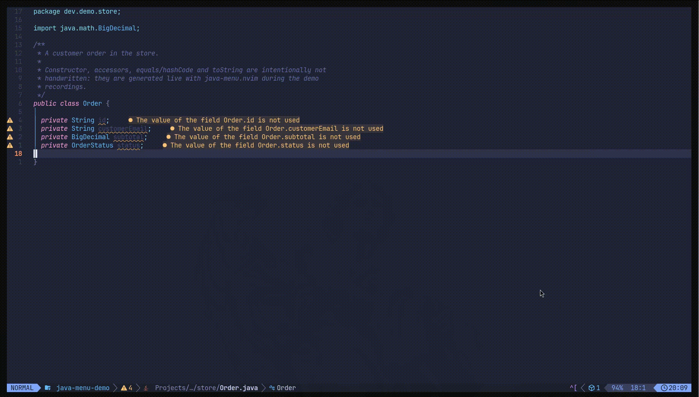
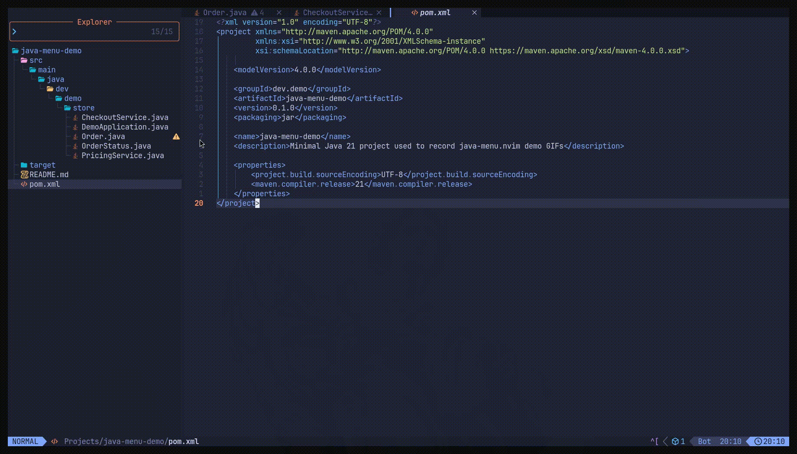
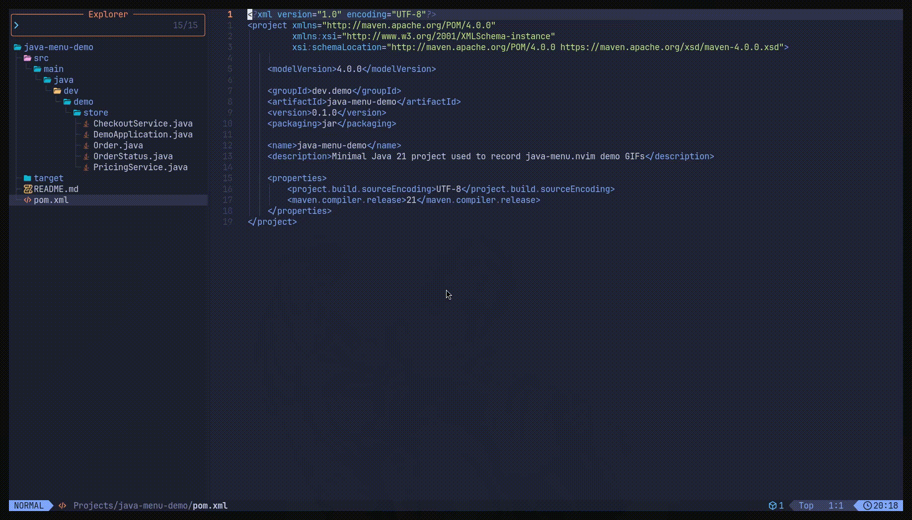

# java-menu.nvim

**A contextual Java workflow interface for Neovim, built on top of [jc.nvim](https://github.com/artur-shaik/jc.nvim).**

java-menu.nvim brings commonly used Java operations together through discoverable menus and adds guided workflows for selected refactorings. It does not replace jc.nvim — if you prefer direct commands, keymaps, and jc.nvim's existing interactive tools, you may not need this plugin.



---

## Contents

- [What is java-menu.nvim?](#what-is-java-menunvim)
- [Relationship with jc.nvim](#relationship-with-jcnvim)
- [Features](#features)
- [Requirements](#requirements)
- [Installation](#installation)
- [Configuration](#configuration)
- [Keymaps](#keymaps)
- [Usage and workflows](#usage-and-workflows)
- [Limitations and known issues](#limitations-and-known-issues)
- [Testing and development](#testing-and-development)
- [Credits](#credits)

## What is java-menu.nvim?

java-menu.nvim is a menu layer for Java development in Neovim. Instead of remembering a long list of commands, you open one of eight contextual menus per situation — New, Generate, Refactor, Imports, Build/Run, Tests, Debug, Project — and pick what you need. Every menu entry states plainly whether it is available and, when it is not, why (no jdtls attached, no build tool found, missing plugin, and so on).

Under the hood, the Java work itself is done by jc.nvim and by the jdtls language server you already run. java-menu.nvim organizes those capabilities, adds a few workflows of its own — most notably a **preview-and-apply flow for WorkspaceEdit refactorings** (rename, move, change signature) with cancellation and safety checks — and stays out of the way otherwise.

A quick tour:

1. Press `<leader>jg` in a class with fields. The Generate menu lists Constructor (Select Fields), All-Args Constructor, No-Args Constructor, Getter, Setter, Getter + Setter, `toString()`, `hashCode()`/`equals()` and Abstract Methods. Unavailable entries (say, Abstract Methods in a concrete class) show why instead of failing.
2. Choose a constructor flow. **Constructor (Select Fields)** opens the multi-field picker; **All-Args Constructor** generates every eligible field immediately; **No-Args Constructor** reuses the previous default-constructor implementation and is blocked when a final field still needs initialization. Duplicate constructors are detected before insertion.
3. Press `<leader>jr` and pick `Rename`. After jdtls computes the rename, a review menu lists every affected file with a diff-style preview. You can inspect each file, **Apply**, or **Cancel** — cancelling changes nothing.

## Relationship with jc.nvim

[jc.nvim](https://github.com/artur-shaik/jc.nvim) is a mature Java productivity layer for Neovim: code generation with interactive field selection, a class-creation DSL and wizard, organize-imports with per-project preferences, a neotest-based JUnit runner, gradle/maven task runners, refactorings and debug integration. **It is a mandatory dependency** — java-menu.nvim does not bundle, fork, or reimplement any of that.

What java-menu.nvim does with it:

- **A. Operations provided by jc.nvim.** Code generation (constructors, accessors, `toString`, `equals`/`hashCode`, abstract methods), organize-imports variants (smart, add-missing, remove-unused, no-sort, style presets, wildcard expansion), replace-import, the neotest test runner via jc's adapter, and the extract/static-import/flip-args refactor actions all call jc.nvim's public APIs.
- **B. Functionality java-menu.nvim adds on top:**
  - The **preview → review → apply/cancel** workflow for WorkspaceEdit results (rename, move class, change signature), with modified-buffer blocking, stale-plan revalidation, and a cancel path that touches nothing.
  - A **guided Change Signature** menu (reorder/edit parameters, rename, change modifier and return type, delegate option) driven by jdtls' `java/getChangeSignatureInfo` — jc.nvim has no change-signature command.
  - **Project-scoped build state**: repeat, stop, and output are tracked per project root, so `Repeat` never reruns another project's build, and `Stop` from project B asks before killing project A's process.
  - **Nested module discovery** for Maven (declaration-driven `<modules>` walk) and Gradle (static `settings.gradle(.kts)` parse), including logical Gradle paths (`:services:api:compile`) and `-pl <module> -am` scoping for Maven.
  - **Multi-project guardrails**: when more than one jdtls client is attached, operations that jc.nvim resolves globally are blocked with an explicit reason instead of silently hitting the wrong project.
- **C. Workflows that combine both.** New creates classes through jc's template engine while java-menu resolves the source root, packages, and module from the project (including nested Maven/Gradle modules) and detects JUnit/Spring/JPA availability from the build file; Build/Run picks the module from that same discovery and runs Maven/Gradle directly; Rename/Move go through jdtls and java-menu's preview.

If you are happy driving jc.nvim's commands (`:JCgenerateConstructor`, `:JCimportsOrganizeSmart`, `:JCbuildTask`, …) and mappings directly, you honestly do not need this plugin. java-menu.nvim exists for people who prefer browsing a contextual menu — and for the few workflows above that jc.nvim does not cover.

## Features

**New Class wizard**



- **New** — wizard for Class, Abstract Class, Interface, Enum, Record, Annotation, Exception, Class with main, Singleton, Serializable and jc.nvim's template library (JUnit 5, Spring stereotypes, JPA entity, …). Project-aware package and source-root resolution, `extends`/`implements` search through jdtls when attached, fields with per-kind editing, and availability detection (JUnit/Spring/JPA) from the build file. Basic class creation works **without jdtls**.
- **Generate** — Constructor (Select Fields), All-Args Constructor and No-Args Constructor, getters/setters, `toString()`, `hashCode()`/`equals()`, unimplemented abstract methods. All-Args consumes jdtls' eligible field list without a picker; No-Args keeps the previous default-constructor implementation and refuses to create an invalid constructor when a final field is uninitialized. Interactive selection via jc.nvim, with duplicate detection (an existing equivalent constructor or accessor set is offered for reuse/replacement instead of blindly appended). Requires one jdtls client.
- **Refactor** — extract variable (also all occurrences), extract constant, extract method (visual mode), static import (also enum constants), flip call arguments, rename symbol, move class, and change signature. Rename, Move Class and Change Signature results go through the preview workflow before anything is written. The menu also lists Rename Package and Move Package, but both are permanently disabled: current jdtls offers no supported path for them (rename answers "not supported" for packages, and there is no `moveKind` for package moves) — the entries show that reason instead of pretending to work.
- **Imports** — organize (smart, remembering your choices via jc.nvim), organize with candidate choice, add missing, remove unused, organize without reordering, replace import (pick among same-named types), import style presets, expand wildcard imports.
- **Build / Run** — run a main class (classpath from jdtls), run a Spring Boot application, compile, package, clean, install, or pick a custom goal. Detects `mvnw`/`mvn`/`gradlew`/`gradle` per project (wrapper preferred), runs from the reactor root, scopes Maven runs with `-pl <module> -am` and Gradle runs with `:module:task`. Build output lives in its own buffer; repeat/stop/output are per project; stopping another project's build asks first.
- **Run settings** — save JVM and application arguments per project, choose a Spring profile discovered from `application-*` files, and restart the last process for that project. Run Main and Spring use the root `.env` by default when present; toggle it in **Run Settings…**. It accepts simple `KEY=VALUE` lines and does not execute shell code. Literal values are redacted from captured output, but encoded, transformed, or separately printed fragments cannot be detected; short values can also redact ordinary output. Arguments are stored in a local per-project settings file, so put secrets in `.env` rather than typing them as arguments.

  Restart refuses to stop a running process automatically when its process group cannot be verified. A background process left behind after a normal command exit is allowed to continue and eventually detached from Java Menu's stop controls. **Repeat Last** uses Java Menu's own canonical-root history exclusively and does not read or write jc.nvim's `build-last` (`JCbuildLast`), because `jc.settings` keys projects via non-injective normalized paths without cross-session ownership proof. Short `.env` values can cause unrelated arguments to be treated as secret and excluded from saved history.

  Previously saved Java Menu build histories and run settings without project ownership metadata (including legacy unhashed settings files) are neither imported nor deleted; run a build once or re-save in **Run Settings…** to establish new scoped data.
- **Tests** — run nearest/file/suite/pick via [neotest](https://github.com/nvim-neotest/neotest) with jc.nvim's adapter (classpath from jdtls), re-run last, stop, summary/output and optional precompile. Navigate between a class and its test using module-aware matching (`*Test`, `*Tests`, `*IT`, `Test*`); ambiguous matches are offered for selection, and a missing test can be created after confirmation. The test picker prioritizes the current module and package. Open a project file before invoking the menu from an output buffer. Without neotest the menu says so instead of breaking.
- **Debug** — debug a main class (only launch configs belonging to the current project are offered; ambiguous ones are flagged), debug nearest/class JUnit test via jdtls' java-test, attach to a running JVM, toggle/conditional breakpoints, and the usual session controls — through [nvim-dap](https://github.com/mfussenegger/nvim-dap) and the [java-debug](https://github.com/microsoft/java-debug) bundle.
- **Project** — project-level actions that work even in an empty directory and without jdtls, under `<leader>jp`:
  - **New Project…** — a wizard for **Plain Java**, **Maven**, and **Spring Boot** projects. Plain Java and Maven work completely offline: the wizard asks for a parent directory (default: cwd), project name, base package (default `com.example`) and Java release (default 21 — *informational only* for plain projects, where there is no build file to record it); Maven additionally asks for `groupId` (default: the package) and `artifactId` (default: the name). **Spring Boot** queries the official [Spring Initializr](https://start.spring.io/) REST API (requires network access plus `curl` or `wget` and `unzip` on `PATH`; disabled with a checked reason when a prerequisite is missing): it fetches live metadata for project types (`maven-project`, `gradle-project`, `gradle-project-kotlin`), Spring Boot versions, packaging (`jar`/`war`), Java versions, and dependencies (multi-select, optional), downloads `starter.zip`, validates the archive listing *before* extracting (rejecting empty archives, `..` traversal, absolute/drive paths, backslashes, NULs, symlinks and any non-file/non-directory entry), extracts into a hidden sibling staging directory, re-checks the extracted tree with `lstat`, and publishes by rename — network failures clean up temporary files and offer **Retry** or **Cancel** with zero partial files left behind. Everything across all three kinds is validated before any write: name and Java identifier/package/groupId segments (no keywords), a numeric release, an existing writable absolute parent (resolved via `realpath`), a target that does not exist or is an empty directory, no symlink at the destination, and no unfinished staging leftover. Generation/extraction happens in a hidden sibling staging directory (`.<name>.java-menu-stage`) and is published by atomic rename (entry-by-entry when the target already existed as an empty directory): nothing is written before the final **✔ Create project / ✖ Cancel** confirmation, cancelling at any step creates zero files, and an existing destination is never overwritten (an empty one is reused). Rollback removes only what the operation created; a failure leaves no partial files. A Maven project gets a minimal deterministic `pom.xml` (`modelVersion` 4.0.0, `jar` packaging, version `1.0.0-SNAPSHOT`, UTF-8, `maven.compiler.release=<N>`, **zero dependencies**) plus `src/main/java/<pkg>/Main.java`, `src/main/resources/` and `src/test/java/<pkg>/`; a plain project gets just `src/main/java/<pkg>/Main.java`. `Main.java` is executable and prints `Hello from <name>!`: the wizard uses jc.nvim's `main` template when its output satisfies that contract, but jc.nvim 1.7.0 renders an empty method body, so a small deterministic built-in generator is used today (documented at the fallback site in the code). On success the editor opens `Main.java` (plain/Maven) or `pom.xml` / `build.gradle(.kts)` (Spring Boot, falling back to `*Application.java`) and a notification shows the full path plus a compile/run hint (`javac --release N`, `mvn package`, `./mvnw spring-boot:run`, or `./gradlew bootRun`). Creation does not change your cwd, start jdtls, run `git init`, or execute scripts — generated projects still compile and run for real (the integration specs build them with actual `javac` and Maven).
  - **Project Info…** — a read-only buffer (`q` closes) with root, build tool (Maven | Gradle | Plain Java (no build file)), modules (count + relative paths), source roots, any Gradle dynamic-discovery limitation, and jdtls attached (workspace dir) or not attached. Enabled when a build file (`pom.xml`, `build.gradle`, `settings.gradle`) or a directory with `src/main/java` is found above the buffer.
  - **Environment…** — a read-only buffer (`q` closes) with Neovim version; `java` and `javac` (path + version, or "not found"); `JAVA_HOME`; Maven and Gradle (path + version, or "not found"); `curl` (or `wget`) and `unzip` (for Spring Boot creation); Maven/Gradle wrappers (present / not present / no project); jdtls attached (client count + workspace dir via `project.client_workspace_dir`) or not attached (it never starts anything); jc.nvim available / MISSING (required); and snacks.nvim, which-key.nvim, neotest and nvim-dap available or not found, each with its consequence in parentheses. Strictly informational: it installs, fixes and builds nothing.
  - **Dependencies…** — inspect and manage project dependencies from the build files (enabled whenever a Maven or Gradle project is detected; in multi-module projects, lets you pick the module with the current buffer's module first):
    - **List dependencies…** — read-only report (`q` closes). On Maven, performs a conservative static read of `pom.xml` (ignoring XML comments and `<build>`/`<reporting>` plugin blocks): lists project-level declared dependencies with managed-version provenance (exact local `<dependencyManagement>` matches, explicit overrides, missing versions, and unevaluated `${...}` properties), `<parent>` coordinates with an explicit unresolved-inheritance caveat, `<dependencyManagement>` entries (distinguishing exact entries from `type=pom, scope=import` BOM imports whose artifacts cannot be verified textually), and declared `<profiles>` context (profile IDs, unevaluated `<activation>` metadata, profile-scoped `<dependencyManagement>`, and profile-scoped `<dependencies>`). On Gradle, performs a static read-only parse of Groovy `build.gradle` and Kotlin DSL `build.gradle.kts` dependency declarations (literal coordinates, named/positional `group`/`name`/`version` arguments, multiline calls, and `gradle/libs.versions.toml` catalog aliases, ignoring comments and non-dependency blocks) without executing Gradle scripts, reporting dynamic, interpolated, helper, or scoped forms as explicit partial-parse notes instead of guessing.
    - **Add dependency…** *(Maven only; disabled on Gradle with a checked reason)* — search [Maven Central](https://search.maven.org/) (optional, requires `curl` or `wget`, with manual fallback on failure) or enter `groupId`/`artifactId`/version/scope manually (works offline). Refuses duplicate `groupId`+`artifactId`, respects exact `<dependencyManagement>` matches, notes honestly when `<parent>`/BOM coverage cannot be verified textually, refuses unsaved `pom.xml` buffers, shows a confirmation summary before any write, inserts surgically while preserving bytes, comments, indentation and line endings, and triggers a per-buffer JDTLS re-import (`java/projectConfigurationUpdate`) when a client is attached (never starting one).
    - **Open build file** — opens the target module's `pom.xml`, `build.gradle`, or `build.gradle.kts`.
    - **Sync JDTLS** — sends `java/projectConfigurationUpdate` to the buffer's attached JDTLS client (disabled with reason when not attached).

Menus are available from Java sources, `pom.xml`, `build.gradle(.kts)`, and any buffer inside a Java project — they are not gated on `filetype=java`. Every menu entry that cannot run reports its reason (and the reason is checked, not guessed).

## Requirements

| Dependency | Required? | Used for |
| --- | --- | --- |
| [jc.nvim](https://github.com/artur-shaik/jc.nvim) | **Required** | The Java engine itself: code generation, templates, organize-imports, test adapter. `setup()` fails with a clear error if it is missing. |
| A running **jdtls** | Required for semantic features | Rename/move/change signature, generate, imports, run-main classpath, test/debug integration. You start it yourself (nvim-jdtls, nvim-java, or lspconfig) — java-menu.nvim never starts, installs, or manages the server. Menus that only need the project tree (New, Build/Run) work without it. |
| Neovim | Required | Developed and tested on Neovim 0.12 (Linux, headless and GUI). The practical floor is whatever jc.nvim itself requires — see its README. No older version has been tested. |
| [snacks.nvim](https://github.com/folke/snacks.nvim) | Optional | Pickers/menus. Without it everything falls back to `vim.ui.select`/`vim.ui.input`. |
| [which-key.nvim](https://github.com/folke/which-key.nvim) | Optional | Labels the `<leader>j` group in the popup. |
| [neotest](https://github.com/nvim-neotest/neotest) (+ jc.nvim's adapter/consumer) | Optional | The Tests menu. |
| [nvim-dap](https://github.com/mfussenegger/nvim-dap) + java-debug bundle in jdtls | Optional | The Debug menu. |
| Maven or Gradle (JDK) | Optional | Build/Run. Wrapper scripts (`mvnw`/`gradlew`) are preferred when executable. |
| `curl` (or `wget`) and `unzip` | Optional | **Spring Boot** project creation via Spring Initializr (`curl`/`wget` + `unzip`), and optional **Maven Central** dependency search (`curl`/`wget` only; manual coordinate entry works offline). When missing, those online entries degrade with a clear reason. |

Note on jdtls capabilities: jc.nvim expects jdtls started with its extended client capabilities (nvim-jdtls and nvim-java do this by default). java-menu.nvim adds nothing to that contract and needs no extra server configuration.

Plain Java and Maven project creation need nothing beyond jc.nvim (Maven and `javac`, when present, are used only by *you* to compile and run what the wizard generated). Spring Boot project creation additionally requires network access to `https://start.spring.io`, `curl` (or `wget`), and `unzip`.

## Installation

Install with [lazy.nvim](https://github.com/folke/lazy.nvim) straight from GitHub:

```lua
-- jc.nvim first: a real spec of its own, configured the way you normally would.
-- It must be loaded at startup — java-menu.nvim's setup() needs it right away,
-- so don't gate it behind lazy-loading alone.
{
  "artur-shaik/jc.nvim",
  lazy = false,
  ft = { "java" },
  opts = {
    keys_prefix = "<leader>j",
    default_mappings = false,
  },
},

-- java-menu.nvim, from GitHub
{
  "EdevandoAlves/java-menu.nvim",
  main = "java_menu",
  lazy = false,
  opts = { prefix = "<leader>j" },
  dependencies = { "artur-shaik/jc.nvim" },
},
```

Installing from a local checkout instead? Point `dir` at your clone — everything else stays the same:

```lua
{
  dir = "~/path/to/java-menu.nvim", -- your local clone
  name = "java-menu.nvim",
  main = "java_menu",
  lazy = false,
  opts = { prefix = "<leader>j" },
  dependencies = { "artur-shaik/jc.nvim" },
},
```

Declaring jc.nvim only as an inline `dependencies` entry without a spec of its own does **not** work: lazy.nvim then loads it too late and java-menu.nvim's `setup()` fails with its missing-dependency error (this exact shape was tested and rejected). The `dir` path is wherever you cloned this repository — it is an example, not an install script.

### jdtls is your responsibility

java-menu.nvim never starts jdtls and adds no client configuration. It detects whichever jdtls client is already attached to the buffer, however you started it. A minimal nvim-jdtls-based setup looks like this (the essential part for jc.nvim compatibility is letting nvim-jdtls inject its default `extendedClientCapabilities`, which it does automatically):

```lua
-- in your config: start jdtls for java buffers, with a per-project -data dir
vim.api.nvim_create_autocmd("FileType", {
  pattern = "java",
  callback = function(ev)
    local root = vim.fs.root(ev.file, { "pom.xml", "build.gradle", "settings.gradle" }) or vim.fs.dirname(ev.file)
    require("jdtls").start_or_attach({
      -- collision-free per-project workspace: derived from the full canonical
      -- path, so two projects with the same basename never share a -data dir
      cmd = { "jdtls", "-data", require("java_menu.project").workspace_dir(root) },
      root_dir = root,
    })
  end,
})
```

Do not copy this blindly into a LazyVim/nvim-java setup that already manages jdtls — keep your existing configuration and just make sure java-menu.nvim is added as a plugin.

## Configuration

`require("java_menu").setup(opts)` — or lazy.nvim's `opts`, since the spec above uses `main = "java_menu"`.

```lua
require("java_menu").setup({
  -- Prefix for the menu keymaps (default: "<leader>j").
  prefix = "<leader>j",

  -- Enable/disable menu groups. Keys are the group names below;
  -- anything not listed is enabled (default).
  groups = {
    new = true,
    generate = true,
    refactor = true,
    imports = true,
    build = true,
    tests = true,
    debug = true,
    project = true,
  },

  -- Register the group label with which-key when it is installed
  -- (default: true). Set to false if your config already labels <leader>j.
  which_key = true,
})
```

These are all the options. Behavior you get without asking:

- `setup()` is **idempotent** — running it again removes its own keymaps and command first, then re-registers.
- **Existing keymaps are respected.** If one of the `<leader>j…` keys is already taken by something else, java-menu.nvim keeps that mapping, skips its own, and tells you exactly which one conflicted. Only mappings still owned by java-menu.nvim are ever replaced.
- jc.nvim is checked up front: without it, `setup()` fails with an error naming the missing dependency — no half-registered menus.
- No Java module is loaded during `setup()`; each keymap requires its module on first use.

## Keymaps

Registered globally by `setup()` (not only in Java buffers). `<prefix>` is configurable; the default `<leader>j` is shown.

| Mode | Key | Action | Requirements |
| --- | --- | --- | --- |
| n | `<leader>jn` | New — class/interface/enum/record wizard | works without jdtls; type search needs jdtls |
| n | `<leader>jg` | Generate — select/all-args/no-args constructors, accessors, toString, equals/hashCode, abstract methods | jdtls attached |
| n / x | `<leader>jr` | Refactor — rename, move, extract, static import, flip args, change signature | jdtls attached (menu explains per entry) |
| n | `<leader>ji` | Imports — organize, add/remove, replace, style, expand wildcards | jdtls attached |
| n | `<leader>jb` | Build / Run — run main/spring, compile, package, goal chooser | Maven/Gradle on PATH or wrapper |
| n | `<leader>jt` | Tests — run via neotest + jc.nvim adapter | neotest + jdtls |
| n | `<leader>jd` | Debug — main class, JUnit test, attach, breakpoints | nvim-dap + java-debug |
| n | `<leader>jp` | Project — new plain/Maven/Spring Boot project, project info, dependencies, environment | works without jdtls (Spring Boot needs `curl`/`wget` + `unzip` + network; JDTLS sync needs attached client) |

Plus:

- **`:JavaMenu [group]`** — the same entries as an Ex command, with completion for `new | generate | refactor | imports | build | tests | debug | project`.
- **`require("java_menu").trigger(name)`** — Lua entry point for lazy-loading a single group from your own `keys` specs.
- **Which-key**: with `which_key = true` (the default) and which-key.nvim installed, `<leader>j` is registered as a labeled group, so the popup shows the sub-keys as you type.

These keymaps belong to java-menu.nvim. jc.nvim ships its own separate command/mapping set (see its README) — this documentation does not duplicate it, and java-menu.nvim's `setup()` never overwrites a non-java-menu mapping (see Configuration).

## Usage and workflows

### Maven compile



**Preview before applying a refactoring.** Rename, Move Class, and Change Signature do not write immediately. jdtls computes a WorkspaceEdit; java-menu.nvim normalizes it into an ordered plan and shows a review menu listing every affected file. Selecting a file opens a diff view; `Apply` performs the file operations (renames, creates, deletes go to disk) and applies the text edits into your buffers — it deliberately **never saves them** (`:wa` is yours to run). `Cancel` aborts with nothing changed. Before applying, the plan is revalidated: buffers with unsaved modifications to affected files block the apply (with a notice), and if a file changed on disk since the preview opened, the operation refuses rather than corrupting it.

**Change Signature.** With the cursor on a method, the menu reads the signature from jdtls and lets you reorder parameters, edit parameter names/types/defaults, rename the method, change visibility and return type, and optionally generate delegate methods. The resulting refactoring goes through the same preview workflow.

**Build isolation across projects.** Build state (current command, last run, output buffer ownership) is keyed by project root. One build process runs at a time: starting a build — including `Repeat` — while something is already running is refused with a notice; stop first. What the per-project keying buys you: `Repeat` in project A reruns A's last goal, never B's; `Stop` in project A stops A's process; and if the running process belongs to a different project than the buffer you stopped from, you get an explicit “keep / terminate” prompt before anything is killed.

**Two projects at once.** Each buffer talks to its own jdtls client (client selection is per buffer). Semantic operations that jc.nvim resolves against a single global client are blocked with an explanatory reason while more than one client is attached; per-buffer operations such as rename, move, and replace-import keep working.

**New class without a language server.** Open any file in a Maven/Gradle project (even `pom.xml`), press `<leader>jn`, and create a class — source root, package, and module resolution work from the project files alone. jdtls only becomes necessary when you want type search for `extends`/`implements`.

**Create a project from an empty directory.** `cd` to an empty directory, press `<leader>jp` and choose **New Project…**. Pick Plain Java, Maven, or Spring Boot, answer the prompts (build type, Spring Boot version, packaging, Java version, coordinates, and optional dependencies for Spring Boot), review the summary and confirm with **✔ Create project**. Nothing is written before that confirmation; `Main.java` (plain/Maven) or `pom.xml`/`build.gradle(.kts)` (Spring Boot) opens for editing, and you can build/run it yourself with `javac --release 21`, `mvn package`, `./mvnw spring-boot:run`, or `./gradlew bootRun`.

**Project Info / Dependencies / Environment.** In any Java buffer press `<leader>jp` and choose **Project Info…** to see the detected root, build tool, modules, source roots and jdtls state; **Dependencies…** to list declared dependencies, surgically add a Maven dependency (via Maven Central search or offline manual coordinates, with JDTLS re-import when attached), open the build file, or trigger JDTLS sync; or **Environment…** for a read-only report on `java`/`javac`, Maven/Gradle, `curl`/`wget`/`unzip`, wrappers, jdtls and plugin availability. Report buffers close with `q`.

## Limitations and known issues

- **jc.nvim Lua surface beyond its docs.** A few operations call jc.nvim Lua functions that are not part of its documented command/mapping surface: some are explicitly internal (`_filter_type_symbols`, `_prioritize_types`, `_set_import`, used by Replace Import's candidate filtering), others are plain module functions (per-project import-style storage, the busy check). These are contract-checked at runtime: if one is missing or behaves unexpectedly, the affected operation is disabled with a clear reason rather than half-applied. A jc.nvim update could still require an adapter fix.
- **Multiple jdtls clients.** Operations that jc.nvim resolves against one global client are blocked with an explanatory reason while more than one jdtls client is attached: Generate (all of it), every Imports entry except Replace Import, and the Extract Variable / Extract Method / Static Import refactor actions. Per-buffer operations — Rename, Move Class, Change Signature, Replace Import — keep working against their own buffer's client. This is a deliberate guard, not a bug.
- **Gradle discovery is static.** Nested Gradle modules are found by parsing `settings.gradle(.kts)` includes and explicit `projectDir` entries. Dynamic declarations (e.g. `rootProject.children.each {…}`) are not evaluated; discovery then reports a partial-result note instead of inventing modules. Real Gradle multi-module task execution (`build_gradle_real_spec`) runs when `gradle` is on `PATH` and skips cleanly as `SKIP` when absent; Maven execution is always tested when `mvn` is available.
- **Everything semantic needs jdtls.** Generate, Refactor, Imports, run-main classpath, Tests and Debug menus degrade to explained reasons without an attached server. Only New, Build/Run and Project work standalone.
- **Plain Java projects have no build file.** The Build/Run menu does not apply to them, and the Java release you enter in the wizard is purely informational — nothing records it (there is no `pom.xml`/`build.gradle` to put it in). Project Info still detects such projects through a `src/main/java` directory.
- **Generated `Main.java` uses the built-in generator today.** The jc.nvim `main` template path exists and is used automatically whenever the rendered output satisfies the contract (package + `static void main` + `Hello from <name>!`), but jc.nvim 1.7.0 renders an empty method body, so a small deterministic embedded generator produces the file in practice.
- **Spring Boot creation requires network access.** Versions, project types and dependencies are fetched live from [Spring Initializr](https://start.spring.io/) rather than maintaining a local version matrix. It requires `curl` (or `wget`) and `unzip` on `PATH`; offline or failed requests offer Retry/Cancel and leave no partial directory.
- **Dependencies are text-parsed; Gradle is read-only.** Maven dependency insertion preserves bytes/comments without an XML parser, but textual `<parent>` or BOM imports cannot prove per-artifact version coverage (both the report and the add wizard state this explicitly when `<version>` is omitted without an exact local `<dependencyManagement>` match). Maven `<profiles>` declarations (IDs, declared `<activation>` metadata, profile-scoped `<dependencyManagement>`, and profile-scoped `<dependencies>`) are listed as conditional without evaluating activation, and `${...}` version properties are shown without evaluation. On Gradle, editing is intentionally disabled (read-only MVP), and static parsing covers Groovy `build.gradle` and Kotlin DSL `build.gradle.kts` literal coordinates/arguments plus `gradle/libs.versions.toml` library aliases without executing Gradle; interpolated/dynamic versions, variables, `platform`/`project`/`files`/`kotlin(...)` helpers, catalog bundles, `constraints`, and scoped/conditional `dependencies` blocks are reported as partial-parse notes — use **Open build file** to inspect or edit them directly.
- **No `git init`, no installs.** Project creation never initializes a repository and never installs or configures any tool.
- **Platform.** Tested on Linux. No Windows/macOS validation has been done.
- **jc.nvim version.** Developed against jc.nvim v1.7.0. Compatibility with other versions is what the runtime contract checks make of it — no version matrix is promised.

## Testing and development

For setup, contribution workflow, and pull request guidance, see [CONTRIBUTING.md](CONTRIBUTING.md).

The repository ships a reproducible test suite (no framework; every spec runs in its own clean headless Neovim session, so no state carries between runs). It is not dependency-free: the fast specs need jc.nvim on the runtimepath, and the integration specs need a real jdtls binary, Maven, and nvim-dap with the java-debug bundle — the runner wires these up from your existing lazy.nvim plugin directory:

```sh
tests/java_menu/run.sh fast         # 21 fast specs — no real server or network needed
tests/java_menu/run.sh integration  # 9 specs with real JDTLS, DAP, Maven, Gradle, javac and Spring Initializr (skips when optional tools/network are absent)
tests/java_menu/run.sh all
```

The integration suite attaches real jdtls clients to temporary Maven projects, performs real renames and generate-constructor calls, attaches nvim-dap, runs a real `mvn -pl <module> -am compile`, exercises real offline multi-module Gradle selection/execution/isolation when `gradle` is on `PATH` (`build_gradle_real_spec`, skipping as `SKIP` when missing), and tests real JDTLS project configuration sync (`java/projectConfigurationUpdate`) after surgical `pom.xml` insertion (`deps_sync_real_spec`). The project-creation specs go further: `project_create_real_spec` generates a Maven and a plain project through the wizard and compiles/runs them with real `mvn`/`java` and `javac`/`java` (checking stdout `Hello from realapp!`); `spring_project_real_spec` fetches live metadata and a real `starter.zip` from Spring Initializr, validates and extracts it in staging, and compiles it with `mvn test-compile` (skipping cleanly when offline or without `curl`/`wget`/`unzip`). Prerequisites and failure interpretation are documented in the runner and the spec headers.

The suite covers real JDTLS generation of `toString()`, `equals()`/`hashCode()` and constructor flows, refactoring and preview, real Plain/Maven/Spring Boot project creation, Maven dependency insertion and JDTLS sync. Run settings, process lifecycle and test navigation have focused fast specs.

## Credits

- **[jc.nvim](https://github.com/artur-shaik/jc.nvim)** by Artur Shaik — the Java engine underneath almost every operation in this plugin: code generation, class templates, organize-imports, the neotest adapter. If you prefer direct commands and mappings over menus, use jc.nvim on its own; it is genuinely good at that. java-menu.nvim is an independent add-on and is **not** affiliated with, endorsed by, or maintained by jc.nvim's author.
- [jdtls](https://github.com/eclipse/eclipse.jdt.ls) (Eclipse JDT Language Server) — the semantic engine both plugins rely on.
- [snacks.nvim](https://github.com/folke/snacks.nvim) — optional picker backend.
- [which-key.nvim](https://github.com/folke/which-key.nvim) — optional keymap discoverability.
- [neotest](https://github.com/nvim-neotest/neotest) and [nvim-dap](https://github.com/mfussenegger/nvim-dap) — optional test runner and debugger integration points.

## License

[MIT](LICENSE) — Copyright (c) 2026 Edevando Alves. jc.nvim is distributed under the MIT license by its author; java-menu.nvim is an independent work built on top of it, not a derivative distribution.
