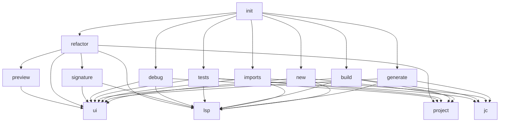
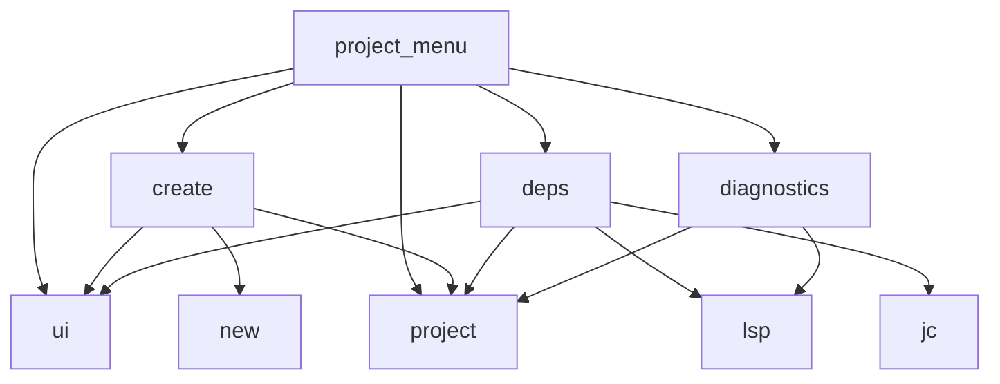

# java-menu.nvim — Java Workbench Architecture

*Phase 7A — architecture plan (no code changes in this phase)*

Index:
1. Product Vision
2. Design Principles
3. Current Architecture
4. Proposed Architecture
5. Module Responsibilities
6. jc.nvim / JDTLS Integration
7. Project Lifecycle
8. UI and Workflow Design
9. Architectural Decisions
10. Implementation Plan 7B–7E
11. Risks and Deferred Work

---

## 1. Product Vision

java-menu.nvim is a **contextual menu layer for Java development in Neovim**. It does not replace an IDE and does not aim for IntelliJ feature parity. Its goal is a coherent, discoverable workbench where a developer can move through the whole Java loop without leaving Neovim: create projects, generate code, refactor, manage dependencies, run, test, debug, work with Spring Boot, and diagnose the environment.

The plugin is deliberately **complementary to jc.nvim**. jc.nvim supplies the Java engine (templates, generators, test adapters, settings); java-menu.nvim supplies the menu ergonomics, state handling, and Neovim-native glue that make those engines convenient in daily work. Where jc.nvim already has a good implementation, this plugin calls it rather than reimplementing it.

Concretely, the "complete flow" the workbench supports (today and planned) is:

- **Create** a plain Java, Maven, or Spring Boot project (7B).
- **Generate** classes, constructors, methods, and boilerplate (exists).
- **Refactor** with previews and LSP-backed operations (exists).
- **Manage dependencies** by reading build files and making surgical edits (7C).
- **Run** builds, mains, and Spring Boot apps with a controlled process lifecycle (exists, 7D extends).
- **Test** via neotest and the jc adapter (exists).
- **Debug** via nvim-dap and java-debug (exists).
- **Diagnose** the JDK / JDTLS / plugin environment read-only (7B–7E).

**Fact** — The current menu already exposes seven groups (`new`, `generate`,
`refactor`, `imports`, `build`, `tests`, `debug`) and the phases 7B–7E are
recorded as planned work in `ROADMAP.md`.

---

## 2. Design Principles

1. **Workflow-first.** Organize around what a developer is doing (create a
   project, run a test) rather than around abstract capabilities. Menus and
   labels are task-oriented.
2. **Integration over reinvention.** Prefer calling jc.nvim and JDTLS over
   building a parallel Java engine. jc.nvim is a **required dependency** and is
   never removed, replaced, monkey-patched, or copied.
3. **Neovim-native.** Use buffers for output, user commands, pickers, LSP
   requests, and the user's existing configuration. Keymaps, `vim.ui.*`, LSP
   clients, and `stdpath` are the native surfaces; no external GUI is introduced.
4. **Minimal complexity.** No generic infrastructure is anticipated ahead of a
   concrete need. New abstractions appear only when a second real consumer
   justifies them (e.g. a shared build-file dependency reader is deferred until
   `deps.lua` genuinely needs it).
5. **Evolutionary architecture.** Changes are incremental and backward
   compatible: no existing module is rewritten in 7B–7E, public APIs such as
   `new.M.create` are preserved, and new behavior is additive.

**Fact** — These principles are consistent with the `ROADMAP.md` "Principles"
section (workflow-first, integration over reinvention, Neovim-native, no
IntelliJ parity, keep leveraging jc.nvim).

---

## 3. Current Architecture

### 3.1 Module inventory

**Fact** — The 14 modules under `lua/java_menu/` and their classifications.
Classifications describe the 7B–7E plan: **REUSE** = use as-is, **EXTEND** = add
to without rewriting, **NEW** = to be created (7B+), **DEFER** = explicitly out
of scope for this generation.

| Module | Lines | Responsibility | Classification |
|---|---|---|---|
| `init.lua` | 211 | Idempotent `setup`, `M.actions` registry (7 groups), keymap-conflict detection preserving third-party maps, `:JavaMenu` + completion, lazy module loading, optional which-key | **EXTEND** (register the new group) |
| `ui.lua` | 214 | Leaf picker layer: `pick_one` / `pick_many` / `ask` with Snacks + `vim.ui.select` / `vim.ui.input` fallback (no global replacement), `menu` with enabled/reason, `notify`, `with_indent`, `same_buffer` | **REUSE** |
| `lsp.lua` | 84 | Leaf: per-buffer jdtls client selection, capabilities, `jc_global_reason` blocking jc global APIs with >1 client | **REUSE** |
| `jc.lua` | 245 | Leaf: thin validated adapter over jc.nvim internals — replace-import API, build-last read/write, import style, test discovery, jdtls busy; disables with a reason on contract drift | **REUSE** |
| `project.lua` | 531 | Leaf: markers, walk-up root, Maven recursive modules, static Gradle module discovery with `discovery_limitation`, source roots, packages, workspace id/dir and `client_workspace_dir` | **REUSE** |
| `new.lua` | 1353 | Wizard for 16 Java kinds + jc templates; build-file text detection (junit/spring/jpa, jakarta vs javax); state machine with edit/back; summary; **public `M.create`** | **REUSE** (`M.create` called as-is) |
| `generate.lua` | 689 | jc `generate_*` + jdtls flows; three constructor flows; duplicate detection; requires exactly one jdtls client | **REUSE** |
| `refactor.lua` | 921 | extract / static import / flip via jc; rename / move / change-signature via per-buffer jdtls with preview; Rename/Move Package permanently disabled with a reason | **REUSE** |
| `preview.lua` | 774 | WorkspaceEdit → ordered plan, review menu, per-file diff, apply/cancel, revalidation; dirty buffers block, on-disk changes refuse, never saves | **REUSE** |
| `signature.lua` | 359 | Guided `java/getChangeSignatureInfo` flow | **REUSE** |
| `imports.lua` | 240 | organize variants, replace import through the jc adapter, styles, wildcards | **REUSE** |
| `build.lua` | 832 | Build-tool wrapper-first (mvnw/gradlew/mvn/gradle), lifecycle + custom goals, per-root repeat + jc build-last, single-process state machine, dedicated output buffer + quickfix efm, kill_tree, Run Main / Run Spring Boot | **EXTEND** (7D process/run profile work; state machine is the base) |
| `tests.lua` | 288 | neotest + jc adapter; nearest/file/suite/pick; rerun/stop/summary; optional precompile; jump to paired test | **EXTEND** (7E bidirectional jump) |
| `debug.lua` | 475 | nvim-dap + java-debug; main/JUnit/attach/breakpoints; launch configs filtered by project | **REUSE** |

New modules planned (7B+): `create.lua`, `deps.lua`, `diagnostics.lua`,
`project_menu.lua` — all **NEW**. See §4 and §5.

### 3.2 Internal dependency graph

**Fact** — Four leaves (`ui`, `lsp`, `jc`, `project`) have no internal
dependencies; `preview` depends only on `ui`. `init` loads every menu module
lazily through the `M.actions` registry.

### 3.3 Coupling points that constrain expansion

- **(a) Single global process — `build.lua`.** **Fact** — one module-level
  `state` table (`job`, `buf`, `kind`, `cmd`, `cwd`, `root`, `running`,
  `status`, `last_output`) represents exactly one running job per Neovim
  session. Starting a second process while one runs is refused; stopping a
  process from another project asks for confirmation. This is a deliberate
  isolation mechanism, but it prevents parallel per-project processes.
- **(b) jc global-client limitation — `lsp.lua`.** **Fact** — `jc_global_reason`
  blocks jc operations that resolve the jdtls client globally when more than
  one jdtls client is attached. The Java Menu itself is per-buffer (`lsp.client`),
  but jc APIs that cannot take a bufnr remain unavailable in multi-project
  sessions.
- **(c) Three regex readers of build files.** **Fact** — `project.lua` reads
  build files for module discovery, `new.lua` reads them as `build_text` for
  framework detection, and `build.lua` reads them for `spring_modules`. Each
  parses textual build files independently. **Unverified** — adding `deps.lua`
  as a fourth reader risks divergence in edge cases (profiles, properties,
  unusual formatting).
- **(d) Manually assembled menus.** **Fact** — each module builds its own
  entry list and calls `ui.menu`. This is acceptable: it is a consistent,
  readable pattern and does not block expansion. No generic menu framework is
  warranted.

---

## 4. Proposed Architecture

**Recommendation** — The post-7B–7E architecture adds a single project-oriented
entry point and three focused modules, while leaving every existing module
byte-for-byte intact except the three explicitly extended ones (`init.lua`,
`build.lua`, `tests.lua`).

- **`project_menu.lua`** hosts the Project menu and delegates to the other
  three new modules. It owns the enabled/reason decisions and the entry list.
- **`create.lua`** owns project scaffolding: plain Java, Maven, and Spring
  Boot (Initializr). It reuses `new.M.create` for Java source files.
- **`deps.lua`** owns dependency inspection and Maven dependency insertion,
  Gradle read-only listing, and JDTLS re-import after a pom edit.
- **`diagnostics.lua`** owns the read-only environment report.

**Conceptual domains vs. modules.** The domains **PROJECT / NEW / GENERATE /
REFACTOR / IMPORTS / DEPENDENCIES / RUN / BUILD / TESTS / DEBUG / ENVIRONMENT**
are responsibility labels only. They are **not** a one-to-one map of menus or
files: DEPENDENCIES and ENVIRONMENT are surfaced inside the single Project menu
(8.2), RUN remains in `build.lua`, and ENVIRONMENT logic lives in
`diagnostics.lua`.

**Recommendation** — No existing module is rewritten. `project.lua` remains a
pure detection leaf; the menu lives in `project_menu.lua` so the detection
layer is not inverted into a UI layer.

---

## 5. Module Responsibilities

API names below are the intended public surface (one line per key function);
signatures are deliberately not fixed here.

### 5.1 `project_menu.lua` (NEW)

- `open()` — build the Project entry list with enabled/reason and dispatch via `ui.menu`.
- `info()` — show detected root, build tool, modules, limitations, and attached client.
- **Does not** scaffold, edit build files, or read jars; it only delegates and formats.

### 5.2 `create.lua` (NEW)

- `project()` — wizard entry: choose kind (plain / Maven / Spring Boot), target, name, and Java version.
- `plain()` — create `src/main/java` skeleton plus a Main class via `new.M.create`.
- `maven()` — plain skeleton plus a minimal deterministic `pom.xml`.
- `spring()` — call the official Spring Initializr REST endpoint and extract the zip safely.
- `validate_target(path, name)` — refuse existing/non-empty targets, non-writable parents, invalid names.
- `safe_unzip(zip, target)` — validate the zip listing, extract into a verified new directory with `unzip -n`, never overwrite.
- **Does not** start jdtls, change the user's cwd, install tools, or mutate any existing project.

### 5.3 `deps.lua` (NEW, 7C)

- `list()` — list declared dependencies from `pom.xml` (and Gradle read-only).
- `add()` — insert one dependency into `pom.xml` preserving bytes and comments.
- `choose_version()` — optional online lookup (search.maven.org) with manual entry always available.
- `sync_jdtls()` — request re-import (`java.project.update`) when a client is attached.
- **Does not** run Maven/Gradle to mutate build files, use an XML library or a custom XML parser, or edit Gradle files (read-only MVP).

### 5.4 `diagnostics.lua` (NEW)

- `report()` — assemble and display a read-only environment report (see §9, AD-7).
- **Does not** install, configure, or start anything; it has no side effects.

---

## 6. jc.nvim / JDTLS Integration

### 6.1 jc.nvim remains mandatory

**Fact** — `init.lua` requires `jc.jdtls` at `setup` time and errors with an
actionable message if jc.nvim is absent. jc.nvim is **never** removed or
replaced. New domains use it where it already provides value:

- **Per-project persistence.** **Fact** — `jc.lua` already reads/writes
  `build-last` via `jc.settings.read_project` / `write_project` (the project
  key is resolved by cwd). **Recommendation** — 7D run profiles and 7B/7C
  project-level settings reuse the same pair; H3 (arbitrary keys) must be
  validated first (§11).
- **Templates via the public wizard.** **Fact** — `new.M.create(kind,
  source_root, pkg, name, opts)` is public (line 457) and must never be
  overwritten. `new.lua` supports "extra" jc templates such as `main`.
  **Recommendation** — `create.lua` calls `new.M.create` with a synthetic kind
  `{ template = "main", extra = true }` to render the Main class; `new.lua`
  itself is not modified.
- **Direct public APIs stay direct.** **Fact** — stable jc APIs (`generate_*`,
  `organize_*`, `jc.test.*`, `jc.neotest_adapter`) are called directly from the
  existing modules; the thin adapter is reserved for internals and validated
  contracts.

### 6.2 JDTLS remains the semantic source

**Fact** — The plugin never starts, configures, or manages jdtls; the user
starts it. Semantic operations go through the attached client:
`workspace/symbol` (type search in `new.lua` / replace-import),
`java.project.getClasspaths` and `java.project.getSettings` (`build.lua` Run
Main / JDK), `java.test` (tests), and `java/getChangeSignatureInfo`
(`signature.lua`).

**Unverified / Recommendation** — After a pom edit, `deps.lua` proposes
`workspace/executeCommand "java.project.update"` (the operation nvim-jdtls
wraps as `update_project_config`) to re-import the project. The command name,
arguments, and actual effect are hypothesis **H1** (§11) and must be validated
during implementation. A freshly created project has **no** attached client
until the user opens a file and jdtls attaches; creation never forces an attach.

---

## 7. Project Lifecycle

**Recommendation** — `create.lua` implements three 7B creation paths. All share
a single rule: **no filesystem write occurs before the final confirmation, and
Esc cancels without writing anything.**

### 7.1 Plain Java (offline)

1. Ask target parent directory, project name, base package, and Java version.
2. Validate: target does not exist or is empty; parent is writable; name is a
   valid Java/package identifier.
3. Create `src/main/java/<pkg path>/` and a `Main.java` rendered through
   `new.M.create` with the synthetic jc `main` template.
4. Open the created file in the current buffer and notify the absolute path.

### 7.2 Maven (offline)

1. Same skeleton and Main class as 7.1.
2. Write a **minimal deterministic** `pom.xml`: groupId/artifactId/version from
   the wizard, plus compiler `properties` with the chosen Java version
   (`maven.compiler.source` / `maven.compiler.target` or `release`).
3. Deterministic output means no timestamps, no tool-specific comments, and a
   fixed element order, so results are reproducible and diffable.

### 7.3 Spring Boot (requires network)

1. Ask the same inputs plus Spring Boot version, packaging, and dependencies.
2. Call the **official Spring Initializr REST endpoint** using `curl` or `wget`
   found on PATH, requesting `Accept: application/zip` (endpoint/parameters are
   hypothesis **H2**, §11).
3. Validate the zip listing before extraction: **reject any entry containing
   `..` or an absolute path**. Extract **only** into the verified new target
   directory using `unzip -n` (never overwrite).
4. On network failure: show a clear error and offer retry or cancel; no partial
   directory is left behind.

**Recommendation** — For 7B.2, extract into a hidden staging directory next
to the target, validate every entry path (no `..`, no absolute paths), reject
symlinks and unexpected entry types, and publish by rename only after that;
`unzip -n` alone is not sufficient.

### 7.4 Shared validation and post-creation rules

- **Fact-aligned pattern** — reuse `ui.ask` / `ui.pick_one` and the
  `ui.menu` enabled/reason convention; no new picker stack.
- **Refuse to overwrite** an existing non-empty target; report the offending path.
- **Cancel at any step** (Esc) performs no write.
- **Do not change the user's cwd** without an explicit choice.
- **Do not attach jdtls** by default; the current principle is preserved.
- **Post-creation:** open the main file (or `pom.xml` for Maven/Spring) in the
  current buffer and notify the created path.

---

## 8. UI and Workflow Design

### 8.1 One new group, no changed shortcuts in this phase

**Fact** — `init.lua` registers seven groups under `<leader>j` with suffix keys
`n/g/r/i/b/t/d` and detects keymap conflicts at runtime, preserving
third-party maps and reporting the conflict.

**Recommendation** — Add **one** group, `project`, with proposed key `p`
(`<leader>jp`). Its availability is checked by the **existing** conflict
mechanism; if a user already maps that key, the group is not registered and the
conflict is reported. **No existing shortcut is changed in this phase.**

### 8.2 Project menu entries

- `New Project…`
- `Project Info…`
- `Dependencies…`
- `Environment…`

**Recommendation** — Dependencies and Environment live **inside** the Project
menu. Promotion to their own top-level groups is **DEFER** and only considered
if the Project menu exceeds seven entries.

### 8.3 Scenarios

- **Scenario A — empty directory / no build file.**
  - New Project: enabled (plain and Maven work offline; Spring requires network).
  - Project Info / Dependencies: disabled with reason
    `"no Maven/Gradle project from this directory"`.
  - Environment: always enabled.
- **Scenario B — existing project.** All entries enabled according to detection
  (build tool present, jdtls attached for sync, etc.).

Every unavailable entry shows a **checked reason** through the existing
`ui.menu` pattern — a disabled entry is never silent.

### 8.4 Fallback and automatic extension

**Fact** — Without Snacks, pickers fall back to `vim.ui.select` / `vim.ui.input`
without replacing those globals. **Fact** — `init.lua`'s generic registration
means which-key labels, `:JavaMenu` completion, and `groups.*` overrides extend
automatically when the `project` action is added to `M.actions`.

**Recommendation** — Canceling any Project wizard step writes nothing (§7).

---

## 9. Architectural Decisions

Each decision: Problem / Alternatives / Recommendation / Why / Dependencies /
Risks / Compatibility.

### AD-1 — Spring Boot creation source

- **Problem:** Create a Spring Boot project without shipping a version matrix.
- **Alternatives:** own generator maintaining versions; `mvn archetype:generate` (interactive, slow, requires Maven).
- **Recommendation:** official Spring Initializr REST via `curl`/`wget` + `unzip -n`.
- **Why:** authoritative templates, no local matrix to maintain.
- **Dependencies:** curl or wget and unzip on PATH (H2, H5).
- **Risks:** network failure; contract drift of the REST API.
- **Compatibility:** new `create.lua` only; no existing module touched.

### AD-2 — Plain/Maven creation

- **Problem:** Offline project creation without new global tools.
- **Alternatives:** require Maven/`mvn archetype`; reuse an external scaffold.
- **Recommendation:** internal minimal deterministic generator + jc `main` template via `new.M.create`.
- **Why:** offline, reproducible, no new dependency.
- **Dependencies:** jc.nvim templates; `new.M.create` public API.
- **Risks:** version property choice must stay deterministic.
- **Compatibility:** calls `new.M.create` as-is.

### AD-3 — One Project group

- **Problem:** Where to expose the new domains.
- **Alternatives:** three top-level groups now; a generic action registry.
- **Recommendation:** one `project` group with four entries.
- **Why:** avoids prefix exhaustion and fragmentation.
- **Dependencies:** `init.lua` registry extension.
- **Risks:** group could grow past seven entries.
- **Compatibility:** purely additive to `M.actions`.

### AD-4 — Maven dependency insertion

- **Problem:** Add a dependency without corrupting `pom.xml`.
- **Alternatives:** XML library; own parser; run `mvn` to edit.
- **Recommendation:** surgical text insertion at `</dependencies>`, detected indentation, dedupe by literal `groupId`+`artifactId`, omit `<version>` when BOM/`dependencyManagement` is detected textually (with a note); optional search.maven.org lookup with manual entry always available; sync via `java.project.update` when a client is attached.
- **Why:** preserves bytes and comments; no heavy dependency.
- **Dependencies:** H1 (sync command), network optional.
- **Risks:** regex misses exotic pom formatting.
- **Compatibility:** `deps.lua` centralizes dependency reading; no XML parser.
- **Unverified** — textual `<dependencyManagement>` does not prove that a BOM
  manages a specific artifact; 7C must verify per-artifact coverage before
  omitting `<version>`, or document that limitation explicitly.

### AD-5 — Gradle read-only MVP

- **Problem:** Show Gradle dependencies cheaply.
- **Alternatives:** execute Gradle scripts; full Kotlin DSL parser.
- **Recommendation:** static restricted parse (Groovy `implementation`/`api`/`testImplementation` string coordinates + `libs.versions.toml`); Kotlin DSL DEFER; no script execution; "open build file" navigation as substitute.
- **Why:** safe, no side effects.
- **Dependencies:** Gradle module data from `project.lua`.
- **Risks:** incomplete coverage is reported, not silently wrong.
- **Compatibility:** read-only; no edits to build files.

### AD-6 — Run experience (7D)

- **Problem:** Contextual run profiles and a better process lifecycle.
- **Alternatives:** IntelliJ-style named run configs; global env.
- **Recommendation:** extend `build.lua`: profile from textual scan of `src/main/resources/application*.{yml,properties}`; optional per-project `.env` (`KEY=VALUE`, injected via `jobstart` env, **never logged or notified**); JVM args + app args + profile persisted **per project** via `jc.settings.write_project`; Restart = stop + re-run recorded command; no secret persisted by us.
- **Why:** small, Neovim-native, reuses existing process state.
- **Dependencies:** H3 (arbitrary settings keys); contingency if it fails: own file under `stdpath("data")/java_menu` per root — record, do not implement now.
- **Risks:** single global process persists in the MVP (parallel DEFER); `.env` parsing is simple.
- **Compatibility:** extends `build.lua` state machine; no rewrite.

### AD-7 — Environment diagnostics

- **Problem:** Let users diagnose their Java setup.
- **Alternatives:** auto-fix/install; shell out broadly.
- **Recommendation:** read-only report: JDK (java/Maven/Gradle/wrappers), project+modules+discovery limitation, attached jdtls client + workspace dir via `project.client_workspace_dir`, jc.nvim loadable, snacks/which-key/neotest/dap/java-debug presence.
- **Why:** actionable information, zero side effects.
- **Dependencies:** `project.lua`, `lsp.lua`.
- **Risks:** none expected (read-only).
- **Compatibility:** new `diagnostics.lua` only.

### AD-8 — Ergonomics (7E)

- **Problem:** Small workflow gains without IDE bloat.
- **Alternatives:** tree/explorer, statusline widgets, tool windows (all rejected).
- **Recommendation:** bidirectional class↔test jump (extend the existing paired-test jump in `tests.lua`), contextual defaults per module/buffer, consistency review of reason messages.
- **Why:** high value, low surface area.
- **Dependencies:** `tests.lua` existing jump.
- **Risks:** none structural.
- **Compatibility:** extends `tests.lua`.

### AD-9 — Ordering

- **Problem:** Sequence phases with minimal coupling.
- **Recommendation:** 7B independent → 7C (code-independent of 7B, reuses its patterns) → 7D (extends `build.lua`, not blocked by 7C) → 7E (final integration). Update README each phase: features + requirements (curl/unzip optional in 7B; nothing new in 7C; `.env` caveat in 7D).
- **Why:** each phase is independently shippable.
- **Dependencies:** as listed per phase.
- **Risks:** shared patterns must be copied, not prematurely abstracted.
- **Compatibility:** no cross-phase hard dependency.

### AD-10 — Module/naming summary

- **Problem:** Keep the change surface explicit.
- **Recommendation:** NEW = `create.lua`, `deps.lua`, `diagnostics.lua`, `project_menu.lua`; EXTEND = `init.lua`, `build.lua`, `tests.lua`; **no existing module rewritten**; `project.lua` stays a detection leaf (the menu lives in `project_menu.lua` to avoid inverting the layer).
- **Why:** clear review boundary and stable architecture.
- **Dependencies:** all of the above.
- **Risks:** scope creep if more modules are touched.
- **Compatibility:** fully additive except the three documented extensions.

---

## 10. Implementation Plan 7B–7E

### 7B — Project Management

- **Objective:** create projects and expose the Project menu.
- **Features:** plain / Maven / Spring Boot creation; New Project / Project Info / Environment (Dependencies entry present but disabled until 7C); safe-path and no-overwrite validations.
- **Modules:** NEW `create.lua`, `project_menu.lua`, `diagnostics.lua` (base report); EXTEND `init.lua`.
- **Dependencies:** jc templates + `new.M.create`; curl/wget + unzip for Spring (H2, H5).
- **Tests (fast):** target validation, collision/no-overwrite, cancel-without-write, zip listing rejection of `..`/absolute paths, Project menu states, `project` keymap-conflict behavior.
- **Tests (integration):** Initializr path marked skippable offline.
- **Criteria:** existing 13/13 fast specs still pass + new specs pass; no behavior change in existing flows.
- **README:** add project-creation features and optional curl/unzip requirements.

### 7C — Dependency Management

- **Objective:** inspect and surgically edit Maven dependencies.
- **Features:** list dependencies; insert with comment/byte preservation, dedupe, BOM-omit; optional online version choice; JDTLS re-import; Gradle read-only listing + open-build-file fallback.
- **Modules:** NEW `deps.lua`; EXTEND `init.lua` (Dependencies entry enabled).
- **Dependencies:** jc settings (persistence precedent), H1 sync command; code-independent of 7B but reuses its menu/validation patterns.
- **Tests (fast):** pom insertion preserving comments + dedupe + BOM-omit with fixtures; Gradle static parse; sync called only when a client is attached.
- **Tests (integration):** real JDTLS sync after `java.project.update` on a temporary Maven project, extending the existing style.
- **Criteria:** 13/13 existing + new pass; integration 5/5 when environment available.
- **README:** dependency features; no new requirements.

### 7D — Run Experience

- **Objective:** contextual run profiles and clearer process lifecycle.
- **Features:** profile scan; optional per-project `.env` with mandatory redaction; JVM/app args; per-project persistence; Restart via recorded command.
- **Modules:** EXTEND `build.lua`.
- **Dependencies:** H3 (jc settings arbitrary keys) with documented data-file contingency; not blocked by 7C.
- **Tests (fast):** `.env` parse + redaction (values never in logs/notifications), profile scan, persisted-profile round-trip, restart uses recorded command.
- **Tests (integration):** process lifecycle via existing build-isolation spec style.
- **Criteria:** existing flows unchanged; 13/13 + new specs pass; integration 5/5 when available.
- **README:** run-profile features and `.env` caveat.

### 7E — IDE Workflow Ergonomics

- **Objective:** final integration and small contextual gains.
- **Features:** bidirectional class↔test jump; contextual defaults; reason-message consistency review.
- **Modules:** EXTEND `tests.lua`; light touches to `init.lua`/`ui.lua` registration and wording only if needed.
- **Dependencies:** 7B–7D complete.
- **Tests (fast):** bidirectional jump; reason-message consistency check.
- **Tests (integration):** full 5/5 regression when environment available.
- **Criteria:** 13/13 existing + all new fast specs pass; integration 5/5; README/help updated; no behavior change in existing flows.
- **README:** ergonomics notes; final feature/requirements pass.

**Fact** — The baseline is `fast` = 13 headless specs (jc.nvim on rtp, no
server) and `integration` = 5 specs with real jdtls, nvim-dap + java-debug, and
Maven; each spec runs in a clean `nvim --headless -u NONE -n` session. No hour
estimates are given.

---

## 11. Risks and Deferred Work

### 11.1 Baseline risks

- **jc.nvim API drift.** **Fact** — baseline is jc.nvim **v1.7.0**; internal
  APIs are consumed only through the validated `jc.lua` adapter, which disables
  with a reason on contract drift. New code keeps using public APIs directly.
- **Regex-reader divergence.** **Fact** — three build-file readers exist today
  (`project.lua`, `new.lua`, `build.lua`). **Recommendation** — `deps.lua`
  centralizes **dependency** reading; `new.lua` and `build.lua` are deliberately
  **not** refactored in this generation to avoid churn. This is a conscious
  trade-off, not an oversight.
- **Network unavailable.** Spring creation (7B) and optional version lookup
  (7C) require clear errors + retry/cancel/manual fallback.
- **Prefix exhaustion.** **Fact/Unverified** — the `<leader>j` suffix letters
  are finite; conflict detection reports collisions but cannot create new keys.
- **Single global process.** **Fact** — persists through the 7D MVP; parallel
  per-project processes are **DEFER**.
- **`.env` parsing.** **Recommendation** — simple `KEY=VALUE` only; no `export`,
  no complex quotes (documented limitation); values never logged.
- **Platform.** **Fact** — Linux-first; wrappers and kill_tree assume a POSIX
  environment.

### 11.2 Explicit hypotheses to validate in implementation

- **H1 — JDTLS project sync (validated in 7C).** **Fact** — the actual
  re-import method in `eclipse.jdt.ls` (and `nvim-jdtls`
  `update_project_config`) is `java/projectConfigurationUpdate` with
  `{ uri = vim.uri_from_fname(build_file) }`, not `workspace/executeCommand
  "java.project.update"`. On `eclipse.jdt.ls >= 1.63`, the handler is `void`,
  so LSP4J answers the request with `-32603 "Internal error."` /
  `Local endpoint returned null from its request method` while still running
  the background `Updating project configurations` job; `deps._sync_jdtls`
  reframes only that exact framing artifact and propagates all real errors.
- **H2 — Spring Initializr REST.** **Unverified** — metadata endpoint and zip
  parameters, `Accept: application/zip`; confirm against the live official API.
- **H3 — `jc.settings.write_project` with arbitrary keys.** **Unverified** —
  only `build-last` is observed; validate for run profiles; contingency = own
  file under `stdpath("data")/java_menu` per root (record, do not implement now).
- **H4 — `<leader>jp` availability.** **Unverified** — real user configs may
  already map it; the existing conflict detector reports this rather than
  overriding.
- **H5 — `curl`/`wget` and `unzip` presence.** **Unverified** — check at runtime
  and surface a reason; never auto-install.
- **H6 — project created under an already-covered directory.** **Unverified** —
  jdtls behavior when a new project appears under a directory an attached client
  already covers; report-only.

### 11.3 Deferred work

- Everything marked **DEFER** above: Gradle dependency editing, Kotlin DSL
  (`.kts`) support, dynamic Gradle discovery, parallel per-project processes,
  renaming/moving packages, and promotion of Dependencies/Environment to their
  own top-level groups.
- IntelliJ-style run-configuration UI.
- Tree/explorer, statusline widgets, and tool windows (explicitly rejected in AD-8).
- Any rewrite of an existing module, or installation/configuration of jdtls.
